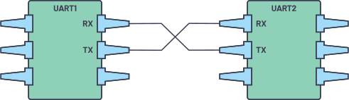

# 串口协议学习与应用

::: warning 建设中
本文档仍处于草稿阶段，内容与实验要求可能调整，仅供参考。具体任务安排与验收要求以实验室确认发布的版本为准。
:::

## 实验背景

之前你已经学习了一些常见的数字电路组件与设计方法，并进行了一些简单的组合应用。现在我们来学习串口通信。UART 是 Universal Asynchronous Receiver/Transmitter 的缩写，即通用异步收发器，是嵌入式设备中常见的一种异步串行字节传输机制，常用于调试和数据传输。

> [!NOTE] 扩展：通信协议的概念
> 通信协议是指双方实体完成通信或服务所必须遵循的规则和约定。在串口通信中，信道（也就是连接我们和开发板的网络通道）中传输的内容是特定的串行数据。而这些数据是无法被我们直接阅读的，因此就需要一些特定的操作，将我们日常使用的二进制数据转换成特定的串行数据后再进行发送，以及对接收到的串行数据解码后得到二进制数据。
> 
除了编码和解码功能，通信协议同时还规定了双方通信的一些准则。即：如何知道此时信道中的数据是有效的数据、如何确定每一段数据的范围、双方的通信频率等。因此，通信协议是一段通信的核心，正确实现了通信协议也就保证了通信的正确性。

UART串口在物理层面其实就是两根数据线：TX、RX。在两个设备之间，常常以这样的方式连接：

在常见的 FPGA 开发板上，往往看不到名为“UART 串口”的独立接口，取而代之的是更常见的 USB 接口，这是出于设计成本与面积考虑。部分板卡使用 **FT2232H** 等 USB-UART 桥接芯片，把 USB 接口同时用于 FPGA 下载和 UART 通信；具体使用哪颗芯片、对应哪个串口，取决于板卡原理图，其他板卡也可能采用 CP2102、CH340 等方案，接线前请先查阅自己板卡的资料。

## 阶段一：UART 基础收发

自己查找资料或参考正点原子/野火的教程与文档，根据UART协议内容，在FPGA上实现串口数据的接收与发送模块

> [!NOTE] 更加一般地：如何学习一种协议？
> 目前我们所接触到的大部分协议，网络上都能找到丰富的教程文档，但是未来的学习或工作中总可能遇到一些生僻的协议或者自定义的技术标准，没有人会教你这些规范如何理解。这时我们应该学会阅读**协议手册**。对于一种特定的协议或标准，定义其完整内容的手册/规范往往是最准确、最权威的。尽管这次的串口协议还没必要从官方协议手册中了解内容，但是大家要做好将来面对未知内容的心理准备。

#### 任务 1：接收字符并显示

PC 发送一个字符，FPGA 使用 8 个 LED 显示最近一次接收到的字节值。
示例：PC 发送ASCII字符 `3`，LED 显示 `0011_0011`。接收结束后，LED 应保持这一状态，直到接收到下一个字节。
> [!NOTE] 什么是 ASCII 码？
> 计算机内部用二进制表示数据，但二进制值本身并不说明它代表哪个字符。ASCII 是一种字符编码标准，为英文字母、数字和常用符号分别规定了对应的 7 位二进制编码。例如字符 `3` 的 ASCII 码是 `0x33`，即 `0011_0011`，所以上面的 LED 会显示这个值。发送方和接收方使用同一套编码，才能把字节正确还原成字符。
#### 任务 2：按键发送字符串

按下 FPGA 开发板上的按键，向 PC 发送一段预先定义的 ASCII 字符串，例如：
- `I like FPGA.`
- `I like Verilog.`
至少完成**一段固定字符串**的发送，确保字符不缺失、不重复、顺序正确。也可以通过多个按键选择不同字符串。
#### 任务 3：串口回环

PC 发送数据，FPGA 将接收到的字节按原顺序返回 PC，测试单字节和连续多字节输入。

**思考**：如果 UART TX 还没有完成上一字节的发送，UART RX 又收到新字节，应该如何处理？

## 阶段二：字符串解析与自动回复

第一阶段实现了字节收发。现在需要让 FPGA 逐字接收并识别 PC 发送的文本命令，随后返回对应字符串。
### 任务要求

| PC 发送内容          | FPGA 应回复               |
| ---------------- | ---------------------- |
| `I like FPGA`    | `I like FPGA, too.`    |
| `I like Verilog` | `I like Verilog, too.` |
| 其他不支持的命令         | `ERROR`                |

#### 思路提示

可以使用状态机逐字匹配，也可以先缓存收到的字节，再进行比较。

## 选做：通过串口控制外设

完成必做内容后，可以进一步把解析出的命令用于控制 FPGA 内部的功能模块，例如此前实现的流水灯、呼吸灯、计时器或小课设中的功能模块。

基本思路是：`uart_rx` 接收命令，命令解析模块把字节或字节序列转换成控制信号，目标模块根据控制信号改变工作状态，`uart_tx` 再返回执行结果。

一个最小的 LED 控制例子：

| PC 发送内容   | 对应动作      | FPGA 回复      |
| --------- | --------- | ------------ |
| `LED ON`  | 点亮 LED    | `OK`         |
| `LED OFF` | 熄灭 LED    | `OK`         |
| `LED ?`   | 查询 LED 状态 | `ON` 或 `OFF` |

命令格式、解析方式、是否需要 FIFO 缓存等，由你根据自己的应用场景决定，并在验收时说明理由。

完整的架构说明和呼吸灯控制示例见[串口外设控制扩展](./extensions/uart-peripheral)。

## 其他选做内容

- 使用 Python（如 `pyserial`）编写上位机程序，自动发送命令并检查回复。

- 支持在上一条回复发送期间接收后续命令，分析是否需要缓存。

- 尝试中文收发，了解 UTF-8 编码与 UART 字节传输的关系。
