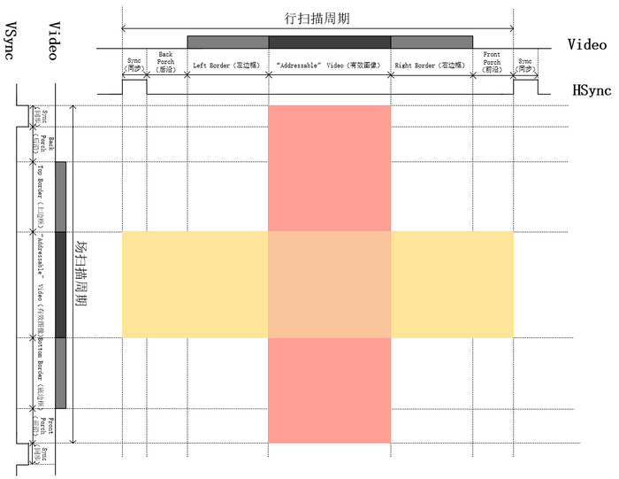
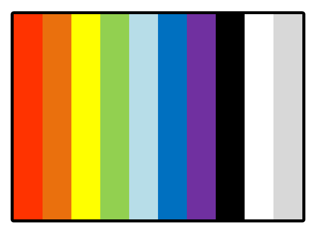

# VGA 图像显示实验

::: warning 建设中
本文档仍处于草稿阶段，内容与实验要求可能调整，仅供参考。具体任务安排与验收要求以实验室确认发布的版本为准。
:::

## 实验介绍

前面的实验中，你已经完成了串口综合应用、Git 基本使用和 valid-ready 握手，这些内容分别对应工程协作、模块间数据接收与传递。AXI-Lite 总线可以作为理解片内总线的扩展，但不是本实验的必要先修内容。本次 VGA 实验会把这些知识放到一个更直观的输出场景中：让 FPGA 按固定时序把像素送到显示器上。

学习 VGA 不是为了记住某一种显示标准，而是借助显示器这个外设了解几个常见问题：

- **实时接口**：VGA 按像素时钟连续扫描，时钟到了就必须给出当前像素，不能像普通数据接口那样随时暂停。
- **坐标化绘图**：把行、场计数转换成屏幕坐标，再根据坐标生成彩条、方块或图片地址。
- **模块组合**：可以用 UART 命令控制图像，也可以用 ROM/RAM 存储图片内容，把前面实验中的模块接到一个完整系统里。
- **带宽和存储**：一帧图像到底需要多少数据，UART 为什么不能直接传整幅图，什么时候需要 ROM、RAM 或双缓冲。
- **调试反馈**：屏幕上的颜色、位置和闪烁现象能直接反映时序、坐标和存储读取是否正确。

完成本实验后，应该能理解一个简单图像显示系统的基本结构，并能把 UART、存储器和像素生成逻辑连接起来。

## 第一阶段：VGA 行列同步时序实现

- **任务**：学习 VGA 显示时序，编写行计数器和场计数器，生成 `hsync`、`vsync` 和 `video_on` 信号，完成 VGA 接口的基础驱动。
- **验证**：
  - **下板**：接上 VGA 显示器，在 `video_on` 有效期间输出固定颜色，例如红色全亮。屏幕能稳定显示红屏且不闪烁，说明时序基本正确。
  - **仿真**：编写 Testbench 测量行周期、场周期、`hsync`/`vsync` 的极性、同步脉冲宽度以及有效显示区边界，并与目标分辨率（如 `640x480@60Hz`）的时序参数逐项比对。仅凭屏幕能稳定显示，不足以证明行、场时序完全正确。



## 第二阶段：VGA 彩条显示

在第一阶段的 VGA 时序模块基础上，增加 `x_pos` 和 `y_pos` 坐标输出。

- **为什么要引入坐标**：第一阶段的行、场计数器覆盖完整 VGA 扫描周期，包括有效显示区、同步脉冲、前沿和后沿。绘图逻辑通常不需要关心这些消隐区，只需要知道当前像素在屏幕上的位置。

  第二阶段需要把扫描计数值转换成有效显示区内的像素坐标：

  - 当 `video_on = 1` 时，`x_pos` 表示当前像素的横坐标，范围为 `0 ~ 639`。
  - 当 `video_on = 1` 时，`y_pos` 表示当前像素的纵坐标，范围为 `0 ~ 479`。
  - 屏幕左上角定义为 `(0, 0)`，右下角定义为 `(639, 479)`。
  - 当 `video_on = 0` 时，当前扫描位置处于消隐区，此时 RGB 应输出黑色或无效值，`x_pos/y_pos` 不用于生成可见图像。
- **推荐模块划分**：

  建议将时序和像素生成分开写：

  ```verilog
  module vga_timing (
      input  wire        pixel_clk,   // VGA 像素时钟，例如 640x480@60Hz 使用约 25MHz
      input  wire        rst_n,

      output wire        hsync,       // 行同步信号
      output wire        vsync,       // 场同步信号
      output wire        video_on,    // 当前扫描位置是否在有效显示区
      output wire [9:0]  x_pos,       // 有效显示区横坐标：0 ~ 639
      output wire [8:0]  y_pos        // 有效显示区纵坐标：0 ~ 479
  );
      // 内部实现：行计数器、场计数器、hsync/vsync/video_on 生成、x_pos/y_pos 生成
  endmodule
  ```

  ```verilog
  module pixel_gen (
      input  wire        pixel_clk,
      input  wire        rst_n,

      input  wire        video_on,
      input  wire [9:0]  x_pos,
      input  wire [8:0]  y_pos,

      output reg  [15:0] rgb          // 示例采用 RGB565：{red[4:0], green[5:0], blue[4:0]}
  );
      // 内部实现：根据 video_on、x_pos、y_pos 决定当前像素颜色
  endmodule
  ```

  如果你使用的板卡的 VGA 接口不是 RGB565，而是 RGB332 或 RGB888 信号，只需要调整 `rgb` 输出位宽和连接方式。坐标接口保持不变，后面的方块移动、ROM 寻址和 RAM 显示都会继续使用它。实际板卡的颜色位数和电阻 DAC 映射取决于原理图：RGB888 通常需要 24 根颜色信号（或经电阻网络合成），不少开发板只引出其中若干位，请以自己板卡的原理图为准。
- **任务**：根据当前的坐标值输出不同的 RGB 颜色。例如，将屏幕按横坐标分为八等份，输出经典的八色彩条，或者画一个简单的国际象棋棋盘格。

  示例思路：

  - 彩条：根据 `x_pos` 所在的横向区间选择不同颜色。
  - 棋盘格：根据 `x_pos` 和 `y_pos` 所在的方格编号决定输出黑色或白色。
  - 背景加方块：当坐标落在某个矩形区域内时输出方块颜色，否则输出背景颜色。
- **验证**：屏幕能稳定显示指定图案，边界清晰，位置正确；`video_on = 0` 时不要输出随机颜色。
  

## 第三阶段：结合 UART 实现动态控制

把串口接收和 VGA 显示结合起来，用 PC 端命令控制屏幕内容。

- **任务**：PC 端通过串口调试助手发送控制字节。例如 `0x01` 表示红色，`0x02` 表示蓝色，`0x03` 表示移动屏幕上的小方块。
- **实现**：FPGA 将 UART 接收到的数据解码，传递给 VGA 像素生成模块。
- **推荐模块连接**：

  ```text
  uart_rx  ->  command_decode  ->  control_regs  ->  pixel_gen
  ```

  `uart_rx` 接收 PC 发来的字节；`command_decode` 把字节解释成颜色、模式或移动方向；`control_regs` 保存当前显示状态；`pixel_gen` 根据 `video_on`、`x_pos`、`y_pos` 和控制寄存器生成 RGB
- **补充**：UART 接收到的数据可以看作一条低速命令流，`uart_rx` 和 `command_decode` 之间建议使用 valid-ready 握手传递命令。例如：

  ```verilog
  // uart_rx -> command_decode
  output wire       cmd_valid,
  output wire [7:0] cmd_data,
  input  wire       cmd_ready
  ```

  `cmd_valid` 表示当前 `cmd_data` 有效，`cmd_ready` 表示后级可以接收。当 `cmd_valid && cmd_ready` 同时为 1 时，命令完成一次传递。如果后级暂时不能处理，`cmd_ready` 可以拉低，前级需要保持 `cmd_valid` 和 `cmd_data` 稳定，直到握手成功。

  需要注意的是，valid-ready 适合用在 UART 命令流、命令解析、寄存器写入这类“可以等待”的模块之间。VGA 像素输出本身不能这样处理：显示器不会给 FPGA 一个 `ready` 信号，像素时钟到了就必须输出当前像素。因此，VGA 端要提前准备好数据，不能依赖下游反压。

  另外，valid-ready 只能约束 FPGA 内部模块之间的传递，无法让 PC 暂停发送。即使 `cmd_ready` 为 0，UART 物理线上的字节仍会继续到达；因此 `uart_rx` 一侧需要足够的接收缓冲，或者在协议上限制命令发送节奏、由上位机等待回复，否则连续输入会溢出丢字节。
- **说明**：本阶段 UART 只传少量控制指令，不传整幅图像的像素数据。VGA 需要约 25MHz 的像素时钟连续输出，UART 远远跟不上。这个带宽问题后面会讨论。
- **注意：CDC（跨时钟域）**

  如果 UART 模块和 VGA 模块使用同一个时钟，可以直接在该时钟域内完成命令解码和控制寄存器更新。

  如果 UART 使用系统时钟，而 VGA 使用独立的 `pixel_clk`，不要直接把 `rx_done`、`rx_data` 接到 VGA 模块。跨时钟直接采样可能导致命令丢失、颜色异常或方块位置错误。

  本阶段可以参考下面的处理方式：

  | **信号类型**   | **典型场景**            | **推荐解决方案**                                     |
  | -------------------- | ----------------------------- | ---------------------------------------------------------- |
  | **单比特事件** | `rx_done`、命令更新标志位   | 脉冲展宽、toggle 同步或握手协议                            |
  | **多比特数据** | `rx_data`、方块坐标、颜色值 | 先在发送时钟域锁存数据，再通过握手协议或小型异步 FIFO 传递 |

  不要直接用 VGA 时钟采样正在变化的多比特 UART 数据总线。
- **扩展阅读**：

  CDC、亚稳态和异步 FIFO 的原理不在这里展开。参考文章：

  - CDC 基础与亚稳态：[跨时钟域解决方法](https://www.cnblogs.com/rouwawa/p/7501319.html)
  - 异步 FIFO 原理：[异步FIFO设计](https://zhuanlan.zhihu.com/p/551351794)

## 第四阶段：实现图像显示：理解存储容量与带宽需求

- **阶段目标**：理解 VGA 图像显示对存储容量和数据带宽的要求。必做任务是用 ROM 显示一张静态图片；RAM 动态缓存和双缓冲作为选做。

### 为什么不能直接用 UART 给 VGA 传像素？

带宽指单位时间内能够传输的数据量。基本公式是：


Bandwidth = f × W


其中，f 是数据传输频率，W 是每次传输的数据位宽。

以 `640x480@60Hz` VGA 为例：

1. **扫描时序总像素数**：包含消隐区在内，一帧通常按 800 × 525 个像素时钟计算。
2. **像素时钟**：800 × 525 × 60 ≈ 25.2  MHz，常见标准值为 `25.175MHz`。
3. **颜色位宽**：假设使用 RGB565，每个像素占 `16 bit`，也就是 `2 Byte`。

如果按每个像素时钟都从存储器读取 16-bit 数据估算：


25.2  MHz × 16  bit ≈ 403  Mbps ≈ 50.4  MB/s


如果只计算有效显示区的图像数据量：


640 × 480 × 60 × 16  bit ≈ 295  Mbps ≈ 36.9  MB/s


再看 UART。以 `115200` bps 为例，串口通常 1 个起始位、8 个数据位、1 个停止位，所以每传 1 Byte 实际需要 10 bit：


115200  bit/s ÷ 10 ≈ 11520  Byte/s ≈ 11.5  KB/s


如果要通过 UART 传输一帧 `640x480` 的 RGB565 图像：


640 × 480 × 2 = 614400  Byte


614400 ÷ 11520 ≈ 53.3  s


UART 传完一帧完整图片大约需要 53 秒，而 VGA 每秒要刷新 60 帧。所以 UART 适合传控制命令，不适合直接作为 VGA 的实时像素来源。

### 必做任务：ROM 静态图片显示

- **任务**：使用 FPGA 内部 Block ROM 存储一张小尺寸图片，并在 VGA 屏幕上显示出来。
- **实现方案**：用 Python 或 MATLAB 脚本将 BMP、JPG 或 PNG 图片转换为 `.coe` 或 `.mif` 文件。然后例化 Block ROM IP，用该文件初始化 ROM。
- **VGA 读取逻辑**：当 VGA 当前扫描坐标 `(x_pos, y_pos)` 落在图片显示区域内时，将屏幕坐标转换为 ROM 地址：

  
Addr = (y_pos - y_offset) × WIDTH + (x_pos - x_offset)


  其中，`WIDTH` 是图片宽度，`x_offset/y_offset` 是图片左上角在屏幕中的显示位置。
- **图片尺寸**：图片不能随意选太大，主要受 FPGA 内部 BRAM 容量和颜色位宽限制。

  
Storage = ImageWidth × ImageHeight × BitsPerPixel


  以 RGB565 为例：

  | **图片尺寸** | **所需容量**                                                  |
  | ------------------ | ------------------------------------------------------------------- |
  | `128x128`        | 128 × 128 × 16 = 262144  bit = 32  KB   |
  | `320x240`        | 320 × 240 × 16 = 1228800  bit = 150  KB |
  | `640x480`        | 640 × 480 × 16 = 4915200  bit = 600  KB |

  选图前先查所用 FPGA 芯片的 BRAM 总容量，并给其他模块预留资源。
- **ROM 读延迟**：Block ROM 通常是同步读。地址在当前 `pixel_clk` 送入后，像素数据可能到下一个 `pixel_clk` 才输出。注意同步延迟 `video_on`、图片区域判断信号或 RGB 输出，否则图像可能横向错位一拍。
- **验证**：屏幕能在指定位置稳定显示图片，图片边界正确，背景区域颜色正常，没有明显错位、闪烁或随机色块。

### 选做任务：单片双口 RAM 动态缓存

- **任务**：理解“显存”的基本概念，观察 UART 慢速写入和 VGA 快速读取之间的差异。
- **实现方案**：例化一个双端口 RAM（Simple Dual-Port RAM）。写端口连接 UART 接收模块，用于慢速写入图像数据；读端口连接 VGA 模块，由 `pixel_clk` 驱动并根据 `(x_pos, y_pos)` 循环读取显示数据。
- **现象**：双口 RAM 可以让 UART 写入和 VGA 读取同时进行，也可以作为跨时钟域缓冲。但 UART 写满一帧很慢，VGA 每秒刷新 60 次，屏幕上会看到新图像逐步覆盖旧图像。如果画面在更新过程中发生变化，可能出现上半部分是新画面、下半部分是旧画面的**画面撕裂（Tearing）**。
- **验证**：能够通过 UART 向 RAM 写入图像数据，并在 VGA 上显示出来；在写入过程中观察并解释画面逐步刷新或撕裂的现象。

### 选做任务：双 RAM 乒乓缓存

- **任务**：理解双缓冲（Double Buffering）如何消除画面撕裂。
- **实现方案**：例化两片相同大小的 RAM，记为 `RAM_0` 和 `RAM_1`，并引入一个状态标志位 `write_bank`。

  - 当 `write_bank = 0` 时，UART 向 `RAM_0` 写入新的一帧数据，同时 VGA 从 `RAM_1` 读取已经完成的旧帧。
  - 当 UART 完整写完一帧后，只在安全时机翻转 `write_bank`，例如在 VGA 一帧结束或场消隐期间切换。
  - 下一帧中，UART 向 `RAM_1` 写入，VGA 从 `RAM_0` 读取。
- **说明**：VGA 始终读取已经写完整的一帧，UART 写入另一片暂时不显示的 RAM。这样用两倍存储空间换取帧完整性，避免显示端读到“写到一半”的画面。
- **验证**：切换图片或更新画面时，屏幕显示应以整帧为单位变化，不再出现明显的上下撕裂。

## 参考资料

- [ustc VGA实验](https://soc.ustc.edu.cn/Digital/2025/lab8/vga/)
- [野火FPGA vga显示器驱动设计与验证](https://doc.embedfire.com/fpga/altera/ep4ce10_pro/zh/latest/code/vga.html)
